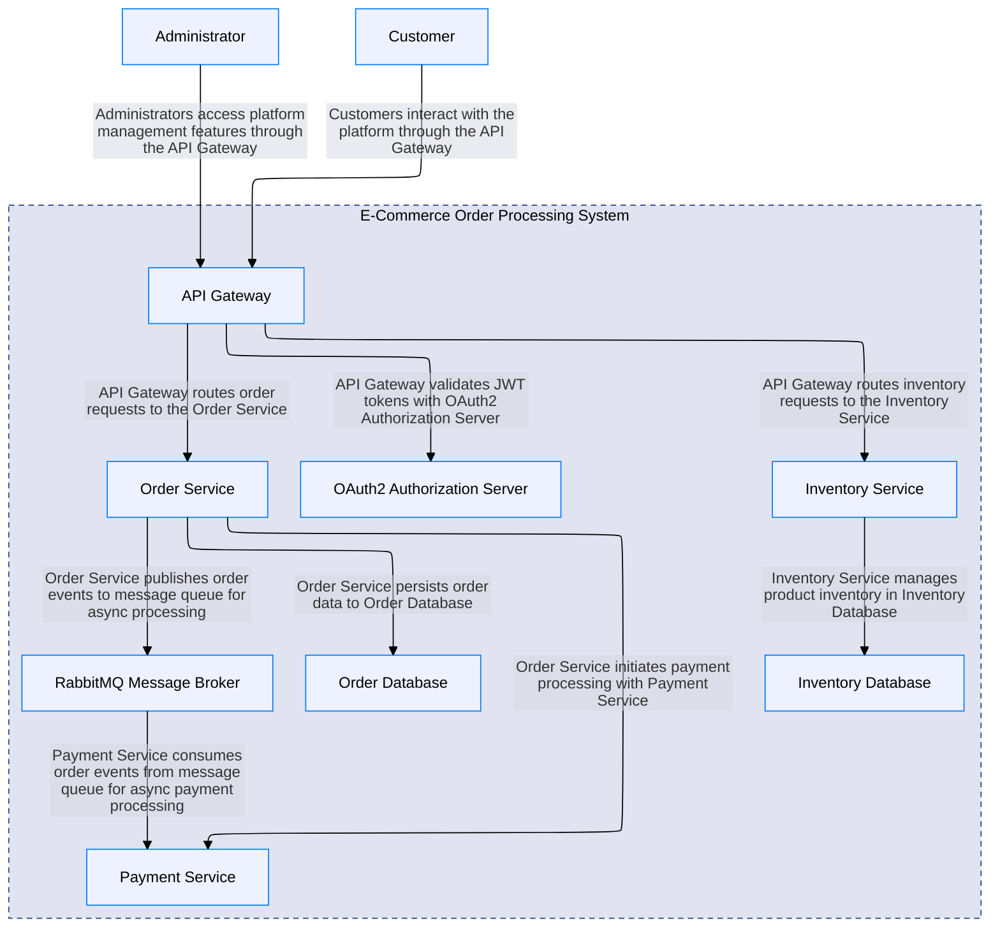

# Welcome to CALM Documentation

This documentation is generated from the **CALM Architecture-as-Code** model.

## High Level Architecture

## Nodes
- [Customer](nodes/customer-actor.md)
- [Administrator](nodes/admin-actor.md)
- [API Gateway](nodes/api-gateway.md)
- [Order Service](nodes/order-service.md)
- [Inventory Service](nodes/inventory-service.md)
- [Payment Service](nodes/payment-service.md)
- [OAuth2 Authorization Server](nodes/oauth2-auth-server.md)
- [RabbitMQ Message Broker](nodes/rabbitmq-message-broker.md)
- [Order Database](nodes/order-database.md)
- [Inventory Database](nodes/inventory-database.md)
- [E-Commerce Order Processing System](nodes/ecommerce-platform-system.md)

## Relationships
- [Customer Interacts With Gateway](relationships/customer-interacts-with-gateway.md)
- [Admin Interacts With Gateway](relationships/admin-interacts-with-gateway.md)
- [Gateway To Order Service](relationships/gateway-to-order-service.md)
- [Gateway To Inventory Service](relationships/gateway-to-inventory-service.md)
- [Order To Payment Service](relationships/order-to-payment-service.md)
- [Order Service To Db](relationships/order-service-to-db.md)
- [Inventory Service To Db](relationships/inventory-service-to-db.md)
- [Platform Composed Of Services](relationships/platform-composed-of-services.md)
- [Gateway To Auth Server](relationships/gateway-to-auth-server.md)
- [Order Service To Rabbitmq](relationships/order-service-to-rabbitmq.md)
- [Rabbitmq To Payment Service](relationships/rabbitmq-to-payment-service.md)

## Flows
- [Customer Order Processing](flows/order-processing-flow.md)
- [Inventory Stock Check](flows/inventory-check-flow.md)

## Metadata

    <table>
        <thead>
        <tr>
            <th>Key</th>
            <th>Value</th>
        </tr>
        </thead>
        <tbody>
        <tr>
            <th>Owner</th>
            <td>piyush.kumar4@ust.com</td>
        </tr>
        <tr>
            <th>Version</th>
            <td>1.0.0</td>
        </tr>
        <tr>
            <th>Created</th>
            <td>2026-11-20</td>
        </tr>
        <tr>
            <th>Environment</th>
            <td>production</td>
        </tr>
        <tr>
            <th>Business Domain</th>
            <td>E-Commerce</td>
        </tr>
        <tr>
            <th>Tags</th>
            <td>ecommerce, microservices, orders, inventory, payments</td>
        </tr>
        <tr>
            <th>Deployment Type</th>
            <td>kubernetes</td>
        </tr>
        <tr>
            <th>Architecture Pattern</th>
            <td>microservices</td>
        </tr>
        </tbody>
    </table>

## Architecture Decision Records

See the [Architecture Decision Records](../../adr/README.md) in the main documentation for:
- **ADR-0001**: Use Message Queue for Asynchronous Order Processing
- **ADR-0002**: Use OAuth2 for API Authentication

These ADRs document the key architectural decisions reflected in this CALM model.
