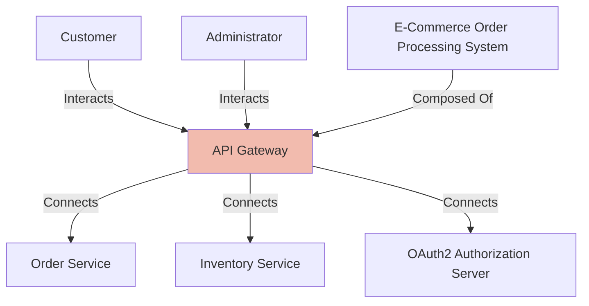

# API Gateway

## Details

    <table>
        <tbody>
        <tr>
            <th>Unique Id</th>
            <td>api-gateway</td>
        </tr>
        <tr>
            <th>Name</th>
            <td>API Gateway</td>
        </tr>
        <tr>
            <th>Description</th>
            <td>Entry point for all client requests, handles routing, authentication, and request validation</td>
        </tr>
        <tr>
            <th>Node Type</th>
            <td>service</td>
        </tr>
        </tbody>
    </table>

## Interfaces

    <table>
        <thead>
        <tr>
            <th>Unique Id</th>
            <th>Host</th>
            <th>Port</th>
        </tr>
        </thead>
        <tbody>
        <tr>
            <td>gateway-http-api</td>
            <td></td>
            <td></td>
        </tr>
        <tr>
            <td>gateway-auth-interface</td>
            <td></td>
            <td>443</td>
        </tr>
        </tbody>
    </table>

## Related Nodes

## Controls
### Security

OAuth2 and JWT authentication security requirements

    <table>
        <thead>
        <tr>
            <th>Key</th>
            <th>Value</th>
        </tr>
        </thead>
        <tbody>
        <tr>
            <td><b>SEC 003</b></td>
            <td>
                <table class="nested-table">
                        <tbody>
                        <tr>
                            <td><b>Requirement Url</b></td>
                            <td>
                                https://calm.finos.org/release/1.3/meta/control-requirement.json
                                    </td>
                        </tr>
                        <tr>
                            <td><b>Control Id</b></td>
                            <td>
                                SEC-003
                                    </td>
                        </tr>
                        <tr>
                            <td><b>Name</b></td>
                            <td>
                                OAuth2 implementation
                                    </td>
                        </tr>
                        <tr>
                            <td><b>Description</b></td>
                            <td>
                                Implement RFC 6749 OAuth2 with authorization_code and client_credentials flows
                                    </td>
                        </tr>
                        </tbody>
                    </table>
            </td>
        </tr>
        <tr>
            <td><b>SEC 004</b></td>
            <td>
                <table class="nested-table">
                        <tbody>
                        <tr>
                            <td><b>Requirement Url</b></td>
                            <td>
                                https://calm.finos.org/release/1.3/meta/control-requirement.json
                                    </td>
                        </tr>
                        <tr>
                            <td><b>Control Id</b></td>
                            <td>
                                SEC-004
                                    </td>
                        </tr>
                        <tr>
                            <td><b>Name</b></td>
                            <td>
                                JWT token security
                                    </td>
                        </tr>
                        <tr>
                            <td><b>Description</b></td>
                            <td>
                                Use RS256 algorithm for JWT signing, rotate keys every 90 days, validate expiry
                                    </td>
                        </tr>
                        </tbody>
                    </table>
            </td>
        </tr>
        <tr>
            <td><b>SEC 005</b></td>
            <td>
                <table class="nested-table">
                        <tbody>
                        <tr>
                            <td><b>Requirement Url</b></td>
                            <td>
                                https://calm.finos.org/release/1.3/meta/control-requirement.json
                                    </td>
                        </tr>
                        <tr>
                            <td><b>Control Id</b></td>
                            <td>
                                SEC-005
                                    </td>
                        </tr>
                        <tr>
                            <td><b>Name</b></td>
                            <td>
                                Token lifecycle
                                    </td>
                        </tr>
                        <tr>
                            <td><b>Description</b></td>
                            <td>
                                Access tokens expire in 1 hour, refresh tokens in 30 days, implement token revocation
                                    </td>
                        </tr>
                        </tbody>
                    </table>
            </td>
        </tr>
        </tbody>
    </table>

### Performance

API Gateway rate limiting and caching requirements

    <table>
        <thead>
        <tr>
            <th>Key</th>
            <th>Value</th>
        </tr>
        </thead>
        <tbody>
        <tr>
            <td><b>PERF 003</b></td>
            <td>
                <table class="nested-table">
                        <tbody>
                        <tr>
                            <td><b>Requirement Url</b></td>
                            <td>
                                https://calm.finos.org/release/1.3/meta/control-requirement.json
                                    </td>
                        </tr>
                        <tr>
                            <td><b>Control Id</b></td>
                            <td>
                                PERF-003
                                    </td>
                        </tr>
                        <tr>
                            <td><b>Name</b></td>
                            <td>
                                Rate limiting
                                    </td>
                        </tr>
                        <tr>
                            <td><b>Description</b></td>
                            <td>
                                Limit each client to 100 requests per second
                                    </td>
                        </tr>
                        </tbody>
                    </table>
            </td>
        </tr>
        <tr>
            <td><b>PERF 004</b></td>
            <td>
                <table class="nested-table">
                        <tbody>
                        <tr>
                            <td><b>Requirement Url</b></td>
                            <td>
                                https://calm.finos.org/release/1.3/meta/control-requirement.json
                                    </td>
                        </tr>
                        <tr>
                            <td><b>Control Id</b></td>
                            <td>
                                PERF-004
                                    </td>
                        </tr>
                        <tr>
                            <td><b>Name</b></td>
                            <td>
                                Caching
                                    </td>
                        </tr>
                        <tr>
                            <td><b>Description</b></td>
                            <td>
                                Use a default TTL of 300 seconds and private cache control
                                    </td>
                        </tr>
                        </tbody>
                    </table>
            </td>
        </tr>
        </tbody>
    </table>

## Metadata

    <table>
        <thead>
        <tr>
            <th>Key</th>
            <th>Value</th>
        </tr>
        </thead>
        <tbody>
        <tr>
            <th>Version</th>
            <td>2.0.0</td>
        </tr>
        <tr>
            <th>Runtime</th>
            <td>Node.js</td>
        </tr>
        <tr>
            <th>Owner</th>
            <td>Platform Team</td>
        </tr>
        <tr>
            <th>Deployment Type</th>
            <td>kubernetes</td>
        </tr>
        <tr>
            <th>Replicas</th>
            <td>3</td>
        </tr>
        <tr>
            <th>Cpu Request</th>
            <td>500m</td>
        </tr>
        <tr>
            <th>Memory Request</th>
            <td>512Mi</td>
        </tr>
        <tr>
            <th>Authentication</th>
            <td>OAuth2.0 (RFC 6749)</td>
        </tr>
        <tr>
            <th>Token Format</th>
            <td>JWT (RFC 7519)</td>
        </tr>
        <tr>
            <th>Token Validation</th>
            <td>RS256 signature verification</td>
        </tr>
        <tr>
            <th>Oauth2 Grant Types</th>
            <td>authorization_code, client_credentials</td>
        </tr>
        <tr>
            <th>Access Token Ttl</th>
            <td>3600s</td>
        </tr>
        <tr>
            <th>Refresh Token Ttl</th>
            <td>2592000s</td>
        </tr>
        <tr>
            <th>Token Endpoint</th>
            <td>https://auth.ecommerce.internal/oauth2/token</td>
        </tr>
        <tr>
            <th>Jwt Claims</th>
            <td>sub, aud, iss, exp, iat, scope</td>
        </tr>
        <tr>
            <th>Scope Validation</th>
            <td>enabled</td>
        </tr>
        <tr>
            <th>Token Revocation</th>
            <td>supported</td>
        </tr>
        <tr>
            <th>Jwks Cache Ttl</th>
            <td>3600s</td>
        </tr>
        </tbody>
    </table>

