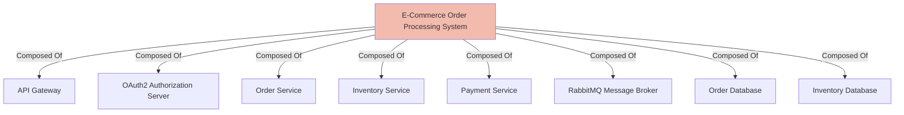

# E-Commerce Order Processing System

## Details

    <table>
        <tbody>
        <tr>
            <th>Unique Id</th>
            <td>ecommerce-platform-system</td>
        </tr>
        <tr>
            <th>Name</th>
            <td>E-Commerce Order Processing System</td>
        </tr>
        <tr>
            <th>Description</th>
            <td>Complete e-commerce platform orchestrating order processing, inventory management, and payment operations</td>
        </tr>
        <tr>
            <th>Node Type</th>
            <td>system</td>
        </tr>
        </tbody>
    </table>

## Interfaces

No interfaces defined.

## Related Nodes

## Controls
_No controls defined._

## Metadata

    <table>
        <thead>
        <tr>
            <th>Key</th>
            <th>Value</th>
        </tr>
        </thead>
        <tbody>
        <tr>
            <th>Version</th>
            <td>1.0.0</td>
        </tr>
        <tr>
            <th>Owner</th>
            <td>piyush.kumar4@ust.com</td>
        </tr>
        <tr>
            <th>Created</th>
            <td>2026-11-20</td>
        </tr>
        <tr>
            <th>Environment</th>
            <td>production</td>
        </tr>
        <tr>
            <th>Architecture Style</th>
            <td>microservices</td>
        </tr>
        <tr>
            <th>Scaling Strategy</th>
            <td>horizontal</td>
        </tr>
        <tr>
            <th>Monitoring</th>
            <td>Prometheus + Grafana</td>
        </tr>
        <tr>
            <th>Logging</th>
            <td>ELK Stack</td>
        </tr>
        <tr>
            <th>Service Mesh</th>
            <td>Istio</td>
        </tr>
        <tr>
            <th>Deployment Type</th>
            <td>kubernetes</td>
        </tr>
        </tbody>
    </table>

