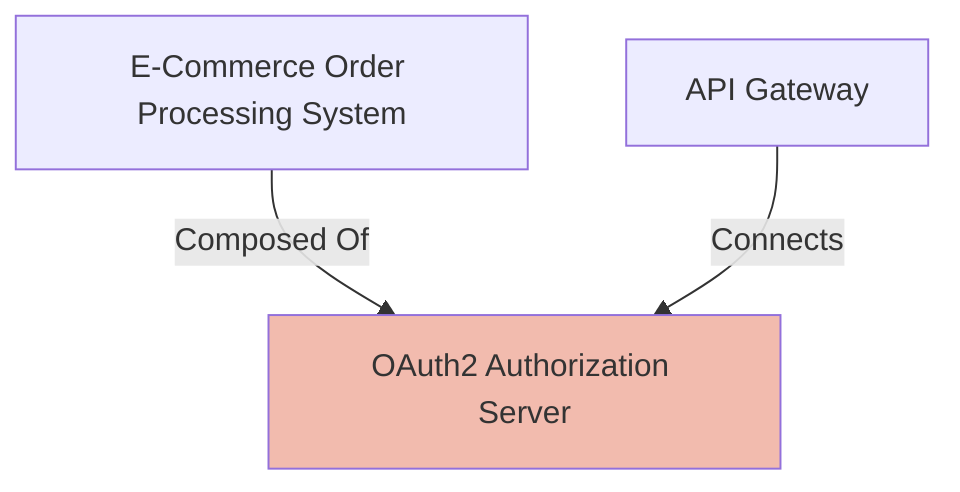

# OAuth2 Authorization Server

## Details

    <table>
        <tbody>
        <tr>
            <th>Unique Id</th>
            <td>oauth2-auth-server</td>
        </tr>
        <tr>
            <th>Name</th>
            <td>OAuth2 Authorization Server</td>
        </tr>
        <tr>
            <th>Description</th>
            <td>Centralized OAuth2 token issuer and validator for API authentication</td>
        </tr>
        <tr>
            <th>Node Type</th>
            <td>service</td>
        </tr>
        </tbody>
    </table>

## Interfaces

    <table>
        <thead>
        <tr>
            <th>Unique Id</th>
            <th>Host</th>
            <th>Port</th>
        </tr>
        </thead>
        <tbody>
        <tr>
            <td>oauth2-token-endpoint</td>
            <td></td>
            <td></td>
        </tr>
        <tr>
            <td>oauth2-authorize-endpoint</td>
            <td></td>
            <td></td>
        </tr>
        <tr>
            <td>oauth2-jwks-endpoint</td>
            <td></td>
            <td></td>
        </tr>
        </tbody>
    </table>

## Related Nodes

## Controls
_No controls defined._

## Metadata

    <table>
        <thead>
        <tr>
            <th>Key</th>
            <th>Value</th>
        </tr>
        </thead>
        <tbody>
        <tr>
            <th>Version</th>
            <td>1.0.0</td>
        </tr>
        <tr>
            <th>Owner</th>
            <td>Security Team</td>
        </tr>
        <tr>
            <th>Runtime</th>
            <td>Java 17</td>
        </tr>
        <tr>
            <th>Framework</th>
            <td>Spring Security</td>
        </tr>
        <tr>
            <th>Deployment Type</th>
            <td>kubernetes</td>
        </tr>
        <tr>
            <th>Replicas</th>
            <td>3</td>
        </tr>
        <tr>
            <th>Oauth2 Standard</th>
            <td>RFC 6749</td>
        </tr>
        <tr>
            <th>Jwt Standard</th>
            <td>RFC 7519</td>
        </tr>
        <tr>
            <th>Token Endpoint</th>
            <td>/oauth2/token</td>
        </tr>
        <tr>
            <th>Authorize Endpoint</th>
            <td>/oauth2/authorize</td>
        </tr>
        <tr>
            <th>Jwks Endpoint</th>
            <td>/.well-known/jwks.json</td>
        </tr>
        <tr>
            <th>Grant Types</th>
            <td>authorization_code, client_credentials, refresh_token</td>
        </tr>
        <tr>
            <th>Access Token Ttl</th>
            <td>3600s</td>
        </tr>
        <tr>
            <th>Refresh Token Ttl</th>
            <td>2592000s</td>
        </tr>
        <tr>
            <th>Jwt Algorithm</th>
            <td>RS256</td>
        </tr>
        <tr>
            <th>Signature Key Rotation</th>
            <td>90 days</td>
        </tr>
        <tr>
            <th>Cpu Request</th>
            <td>500m</td>
        </tr>
        <tr>
            <th>Memory Request</th>
            <td>1Gi</td>
        </tr>
        </tbody>
    </table>

