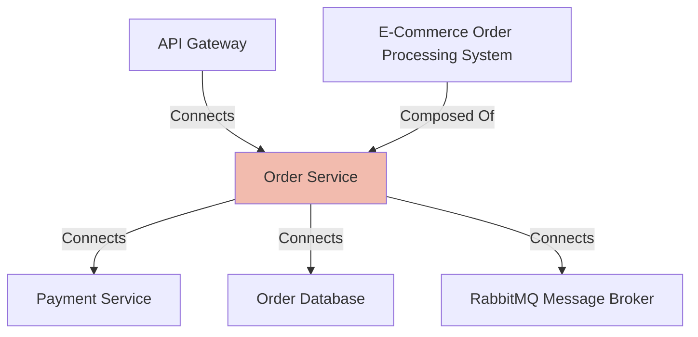

# Order Service

## Details

    <table>
        <tbody>
        <tr>
            <th>Unique Id</th>
            <td>order-service</td>
        </tr>
        <tr>
            <th>Name</th>
            <td>Order Service</td>
        </tr>
        <tr>
            <th>Description</th>
            <td>Core service for managing orders, including creation, tracking, and status updates</td>
        </tr>
        <tr>
            <th>Node Type</th>
            <td>service</td>
        </tr>
        </tbody>
    </table>

## Interfaces

    <table>
        <thead>
        <tr>
            <th>Unique Id</th>
            <th>Host</th>
            <th>Port</th>
        </tr>
        </thead>
        <tbody>
        <tr>
            <td>order-rest-api</td>
            <td></td>
            <td></td>
        </tr>
        <tr>
            <td>order-event-stream</td>
            <td></td>
            <td>9092</td>
        </tr>
        </tbody>
    </table>

## Related Nodes

## Controls
_No controls defined._

## Metadata

    <table>
        <thead>
        <tr>
            <th>Key</th>
            <th>Value</th>
        </tr>
        </thead>
        <tbody>
        <tr>
            <th>Version</th>
            <td>1.5.0</td>
        </tr>
        <tr>
            <th>Runtime</th>
            <td>Java 17</td>
        </tr>
        <tr>
            <th>Framework</th>
            <td>Spring Boot</td>
        </tr>
        <tr>
            <th>Owner</th>
            <td>Order Team</td>
        </tr>
        <tr>
            <th>Database</th>
            <td>order-database</td>
        </tr>
        <tr>
            <th>Replicas</th>
            <td>2</td>
        </tr>
        <tr>
            <th>Cpu Limit</th>
            <td>1000m</td>
        </tr>
        <tr>
            <th>Memory Limit</th>
            <td>2Gi</td>
        </tr>
        </tbody>
    </table>

