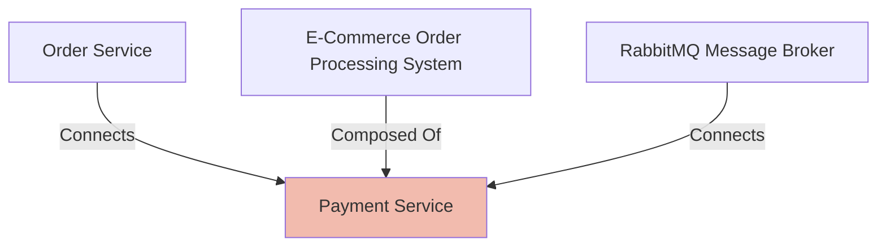

# Payment Service

## Details

    <table>
        <tbody>
        <tr>
            <th>Unique Id</th>
            <td>payment-service</td>
        </tr>
        <tr>
            <th>Name</th>
            <td>Payment Service</td>
        </tr>
        <tr>
            <th>Description</th>
            <td>Handles payment processing, transaction authorization, and payment status tracking</td>
        </tr>
        <tr>
            <th>Node Type</th>
            <td>service</td>
        </tr>
        </tbody>
    </table>

## Interfaces

    <table>
        <thead>
        <tr>
            <th>Unique Id</th>
            <th>Host</th>
            <th>Port</th>
        </tr>
        </thead>
        <tbody>
        <tr>
            <td>payment-rest-api</td>
            <td></td>
            <td></td>
        </tr>
        <tr>
            <td>payment-gateway-interface</td>
            <td></td>
            <td>443</td>
        </tr>
        </tbody>
    </table>

## Related Nodes

## Controls
### Compliance

PCI-DSS compliance for payment processing

    <table>
        <thead>
        <tr>
            <th>Key</th>
            <th>Value</th>
        </tr>
        </thead>
        <tbody>
        <tr>
            <td><b>COMP 001</b></td>
            <td>
                <table class="nested-table">
                        <tbody>
                        <tr>
                            <td><b>Requirement Url</b></td>
                            <td>
                                https://calm.finos.org/release/1.3/meta/control-requirement.json
                                    </td>
                        </tr>
                        <tr>
                            <td><b>Control Id</b></td>
                            <td>
                                COMP-001
                                    </td>
                        </tr>
                        <tr>
                            <td><b>Name</b></td>
                            <td>
                                Payment compliance
                                    </td>
                        </tr>
                        <tr>
                            <td><b>Description</b></td>
                            <td>
                                Payment processing must meet PCI-DSS v4.0 requirements
                                    </td>
                        </tr>
                        </tbody>
                    </table>
            </td>
        </tr>
        </tbody>
    </table>

## Metadata

    <table>
        <thead>
        <tr>
            <th>Key</th>
            <th>Value</th>
        </tr>
        </thead>
        <tbody>
        <tr>
            <th>Version</th>
            <td>1.3.0</td>
        </tr>
        <tr>
            <th>Runtime</th>
            <td>Go</td>
        </tr>
        <tr>
            <th>Owner</th>
            <td>Payment Team</td>
        </tr>
        <tr>
            <th>Compliance</th>
            <td>PCI-DSS</td>
        </tr>
        <tr>
            <th>Encryption</th>
            <td>TLS 1.3</td>
        </tr>
        <tr>
            <th>External Integration</th>
            <td>Stripe, PayPal</td>
        </tr>
        </tbody>
    </table>

