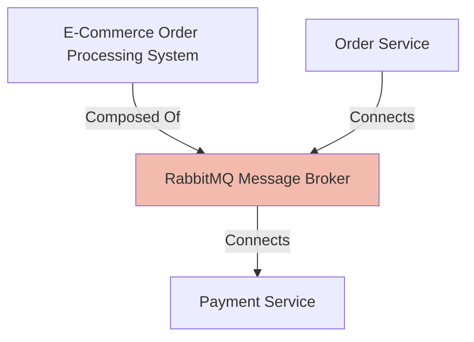

# RabbitMQ Message Broker

## Details

    <table>
        <tbody>
        <tr>
            <th>Unique Id</th>
            <td>rabbitmq-message-broker</td>
        </tr>
        <tr>
            <th>Name</th>
            <td>RabbitMQ Message Broker</td>
        </tr>
        <tr>
            <th>Description</th>
            <td>Message broker for asynchronous order and payment processing</td>
        </tr>
        <tr>
            <th>Node Type</th>
            <td>service</td>
        </tr>
        </tbody>
    </table>

## Interfaces

    <table>
        <thead>
        <tr>
            <th>Unique Id</th>
            <th>Host</th>
            <th>Port</th>
        </tr>
        </thead>
        <tbody>
        <tr>
            <td>amqp-interface</td>
            <td></td>
            <td>5672</td>
        </tr>
        <tr>
            <td>management-api-interface</td>
            <td></td>
            <td></td>
        </tr>
        </tbody>
    </table>

## Related Nodes

## Controls
_No controls defined._

## Metadata

    <table>
        <thead>
        <tr>
            <th>Key</th>
            <th>Value</th>
        </tr>
        </thead>
        <tbody>
        <tr>
            <th>Version</th>
            <td>3.12.0</td>
        </tr>
        <tr>
            <th>Owner</th>
            <td>Platform Team</td>
        </tr>
        <tr>
            <th>Deployment Type</th>
            <td>kubernetes</td>
        </tr>
        <tr>
            <th>Replicas</th>
            <td>3</td>
        </tr>
        <tr>
            <th>Message Durability</th>
            <td>persistent</td>
        </tr>
        <tr>
            <th>Acknowledgments</th>
            <td>enabled</td>
        </tr>
        <tr>
            <th>Queues</th>
            <td>order.created, payment.processed</td>
        </tr>
        <tr>
            <th>Retention Policy</th>
            <td>30 days</td>
        </tr>
        <tr>
            <th>Dead Letter Queue</th>
            <td>enabled</td>
        </tr>
        <tr>
            <th>Cpu Request</th>
            <td>250m</td>
        </tr>
        <tr>
            <th>Memory Request</th>
            <td>512Mi</td>
        </tr>
        <tr>
            <th>Persistent Storage</th>
            <td>10Gi</td>
        </tr>
        </tbody>
    </table>

