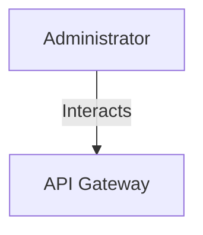

# Admin Interacts With Gateway

## Details

    <table>
        <tbody>
        <tr>
            <th>Unique Id</th>
            <td>admin-interacts-with-gateway</td>
        </tr>
        <tr>
            <th>Description</th>
            <td>Administrators access platform management features through the API Gateway</td>
        </tr>
        <tr>
            <th>Protocol</th>
            <td>HTTPS</td>
        </tr>
        </tbody>
    </table>

## Related Nodes

## Controls
_No controls defined._

## Metadata

    <table>
        <thead>
        <tr>
            <th>Key</th>
            <th>Value</th>
        </tr>
        </thead>
        <tbody>
        <tr>
            <th>Port</th>
            <td>443</td>
        </tr>
        <tr>
            <th>Authentication</th>
            <td>OAuth2 + MFA</td>
        </tr>
        <tr>
            <th>Audit Logging</th>
            <td>enabled</td>
        </tr>
        <tr>
            <th>Access Control</th>
            <td>RBAC</td>
        </tr>
        <tr>
            <th>Sla</th>
            <td>99.95% availability</td>
        </tr>
        </tbody>
    </table>

