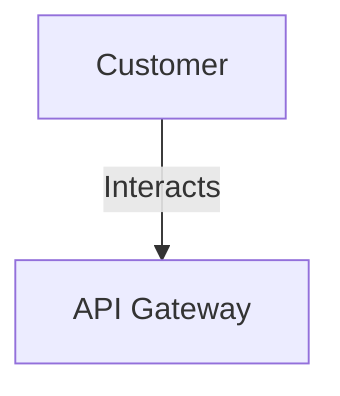

# Customer Interacts With Gateway

## Details

    <table>
        <tbody>
        <tr>
            <th>Unique Id</th>
            <td>customer-interacts-with-gateway</td>
        </tr>
        <tr>
            <th>Description</th>
            <td>Customers interact with the platform through the API Gateway</td>
        </tr>
        <tr>
            <th>Protocol</th>
            <td>HTTPS</td>
        </tr>
        </tbody>
    </table>

## Related Nodes

## Controls
_No controls defined._

## Metadata

    <table>
        <thead>
        <tr>
            <th>Key</th>
            <th>Value</th>
        </tr>
        </thead>
        <tbody>
        <tr>
            <th>Port</th>
            <td>443</td>
        </tr>
        <tr>
            <th>Authentication</th>
            <td>JWT</td>
        </tr>
        <tr>
            <th>Rate Limiting</th>
            <td>1000 requests/minute per user</td>
        </tr>
        <tr>
            <th>Sla</th>
            <td>99.9% availability</td>
        </tr>
        <tr>
            <th>Monitoring</th>
            <td>API request metrics, latency tracking</td>
        </tr>
        </tbody>
    </table>

