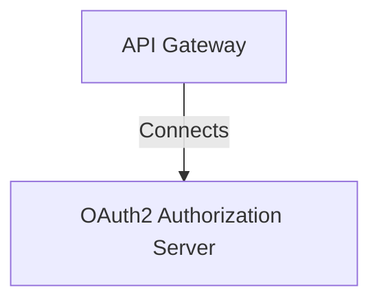

# Gateway To Auth Server

## Details

    <table>
        <tbody>
        <tr>
            <th>Unique Id</th>
            <td>gateway-to-auth-server</td>
        </tr>
        <tr>
            <th>Description</th>
            <td>API Gateway validates JWT tokens with OAuth2 Authorization Server</td>
        </tr>
        <tr>
            <th>Protocol</th>
            <td>HTTPS</td>
        </tr>
        </tbody>
    </table>

## Related Nodes

## Controls
_No controls defined._

## Metadata

    <table>
        <thead>
        <tr>
            <th>Key</th>
            <th>Value</th>
        </tr>
        </thead>
        <tbody>
        <tr>
            <th>Communication Pattern</th>
            <td>synchronous</td>
        </tr>
        <tr>
            <th>Purpose</th>
            <td>token-validation</td>
        </tr>
        <tr>
            <th>Cache Jwks</th>
            <td>true</td>
        </tr>
        <tr>
            <th>Cache Ttl</th>
            <td>3600s</td>
        </tr>
        <tr>
            <th>Timeout</th>
            <td>5000ms</td>
        </tr>
        <tr>
            <th>Circuit Breaker</th>
            <td>enabled</td>
        </tr>
        </tbody>
    </table>

