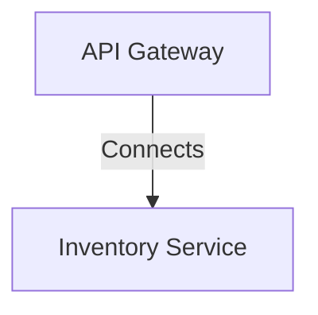

# Gateway To Inventory Service

## Details

    <table>
        <tbody>
        <tr>
            <th>Unique Id</th>
            <td>gateway-to-inventory-service</td>
        </tr>
        <tr>
            <th>Description</th>
            <td>API Gateway routes inventory requests to the Inventory Service</td>
        </tr>
        <tr>
            <th>Protocol</th>
            <td>HTTPS</td>
        </tr>
        </tbody>
    </table>

## Related Nodes

## Controls
_No controls defined._

## Metadata

    <table>
        <thead>
        <tr>
            <th>Key</th>
            <th>Value</th>
        </tr>
        </thead>
        <tbody>
        <tr>
            <th>Routing Type</th>
            <td>load-balanced</td>
        </tr>
        <tr>
            <th>Caching</th>
            <td>Redis cache layer active</td>
        </tr>
        <tr>
            <th>Cache Ttl</th>
            <td>5 minutes</td>
        </tr>
        <tr>
            <th>Timeout</th>
            <td>10000ms</td>
        </tr>
        <tr>
            <th>Sla</th>
            <td>&lt; 200ms p95 latency</td>
        </tr>
        <tr>
            <th>Monitoring</th>
            <td>cache hit rate, inventory updates</td>
        </tr>
        </tbody>
    </table>

