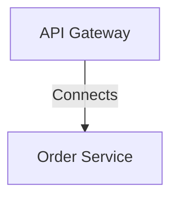

# Gateway To Order Service

## Details

    <table>
        <tbody>
        <tr>
            <th>Unique Id</th>
            <td>gateway-to-order-service</td>
        </tr>
        <tr>
            <th>Description</th>
            <td>API Gateway routes order requests to the Order Service</td>
        </tr>
        <tr>
            <th>Protocol</th>
            <td>HTTPS</td>
        </tr>
        </tbody>
    </table>

## Related Nodes

## Controls
_No controls defined._

## Metadata

    <table>
        <thead>
        <tr>
            <th>Key</th>
            <th>Value</th>
        </tr>
        </thead>
        <tbody>
        <tr>
            <th>Routing Type</th>
            <td>load-balanced</td>
        </tr>
        <tr>
            <th>Circuit Breaker</th>
            <td>enabled</td>
        </tr>
        <tr>
            <th>Timeout</th>
            <td>30000ms</td>
        </tr>
        <tr>
            <th>Retry Policy</th>
            <td>exponential backoff</td>
        </tr>
        <tr>
            <th>Sla</th>
            <td>&lt; 500ms p95 latency</td>
        </tr>
        <tr>
            <th>Throughput</th>
            <td>1000 orders/second peak</td>
        </tr>
        </tbody>
    </table>

