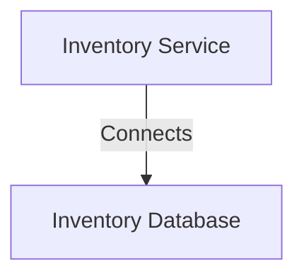

# Inventory Service To Db

## Details

    <table>
        <tbody>
        <tr>
            <th>Unique Id</th>
            <td>inventory-service-to-db</td>
        </tr>
        <tr>
            <th>Description</th>
            <td>Inventory Service manages product inventory in Inventory Database</td>
        </tr>
        <tr>
            <th>Protocol</th>
            <td>JDBC</td>
        </tr>
        </tbody>
    </table>

## Related Nodes

## Controls
_No controls defined._

## Metadata

    <table>
        <thead>
        <tr>
            <th>Key</th>
            <th>Value</th>
        </tr>
        </thead>
        <tbody>
        <tr>
            <th>Connection Pool</th>
            <td>15</td>
        </tr>
        <tr>
            <th>Connection Timeout</th>
            <td>30s</td>
        </tr>
        <tr>
            <th>Ssl Enabled</th>
            <td>true</td>
        </tr>
        <tr>
            <th>Ssl Mode</th>
            <td>require</td>
        </tr>
        <tr>
            <th>Query Timeout</th>
            <td>3000ms</td>
        </tr>
        <tr>
            <th>Replication</th>
            <td>read-replica</td>
        </tr>
        <tr>
            <th>Backup</th>
            <td>daily snapshots</td>
        </tr>
        </tbody>
    </table>

