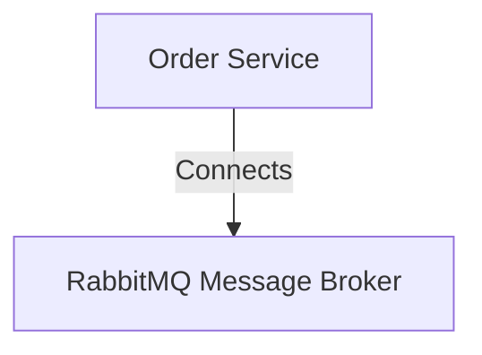

# Order Service To Rabbitmq

## Details

    <table>
        <tbody>
        <tr>
            <th>Unique Id</th>
            <td>order-service-to-rabbitmq</td>
        </tr>
        <tr>
            <th>Description</th>
            <td>Order Service publishes order events to message queue for async processing</td>
        </tr>
        </tbody>
    </table>

## Related Nodes

## Controls
_No controls defined._

## Metadata

    <table>
        <thead>
        <tr>
            <th>Key</th>
            <th>Value</th>
        </tr>
        </thead>
        <tbody>
        <tr>
            <th>Protocol</th>
            <td>AMQP</td>
        </tr>
        <tr>
            <th>Pattern</th>
            <td>publish-subscribe</td>
        </tr>
        <tr>
            <th>Event Types</th>
            <td>order.created, order.pending</td>
        </tr>
        <tr>
            <th>Communication Pattern</th>
            <td>asynchronous</td>
        </tr>
        <tr>
            <th>Message Format</th>
            <td>JSON</td>
        </tr>
        <tr>
            <th>Retry Policy</th>
            <td>exponential backoff</td>
        </tr>
        <tr>
            <th>Dead Letter Queue</th>
            <td>enabled</td>
        </tr>
        </tbody>
    </table>

