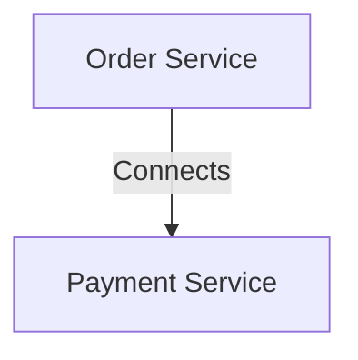

# Order To Payment Service

## Details

    <table>
        <tbody>
        <tr>
            <th>Unique Id</th>
            <td>order-to-payment-service</td>
        </tr>
        <tr>
            <th>Description</th>
            <td>Order Service initiates payment processing with Payment Service</td>
        </tr>
        </tbody>
    </table>

## Related Nodes

## Controls
_No controls defined._

## Metadata

    <table>
        <thead>
        <tr>
            <th>Key</th>
            <th>Value</th>
        </tr>
        </thead>
        <tbody>
        <tr>
            <th>Protocol</th>
            <td>gRPC</td>
        </tr>
        <tr>
            <th>Communication Pattern</th>
            <td>synchronous</td>
        </tr>
        <tr>
            <th>Timeout</th>
            <td>15000ms</td>
        </tr>
        <tr>
            <th>Encryption</th>
            <td>TLS 1.3</td>
        </tr>
        <tr>
            <th>Compliance</th>
            <td>PCI-DSS Level 1</td>
        </tr>
        <tr>
            <th>Retry Policy</th>
            <td>3 retries max</td>
        </tr>
        <tr>
            <th>Sla</th>
            <td>&lt; 5000ms p99 latency</td>
        </tr>
        </tbody>
    </table>

