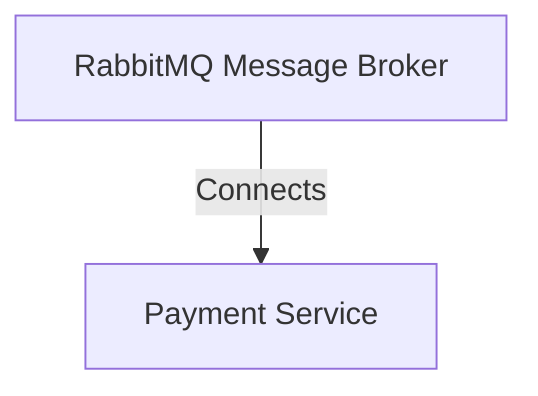

# Rabbitmq To Payment Service

## Details

    <table>
        <tbody>
        <tr>
            <th>Unique Id</th>
            <td>rabbitmq-to-payment-service</td>
        </tr>
        <tr>
            <th>Description</th>
            <td>Payment Service consumes order events from message queue for async payment processing</td>
        </tr>
        </tbody>
    </table>

## Related Nodes

## Controls
_No controls defined._

## Metadata

    <table>
        <thead>
        <tr>
            <th>Key</th>
            <th>Value</th>
        </tr>
        </thead>
        <tbody>
        <tr>
            <th>Protocol</th>
            <td>AMQP</td>
        </tr>
        <tr>
            <th>Pattern</th>
            <td>publish-subscribe</td>
        </tr>
        <tr>
            <th>Consumer Group</th>
            <td>payment-processors</td>
        </tr>
        <tr>
            <th>Communication Pattern</th>
            <td>asynchronous</td>
        </tr>
        <tr>
            <th>Dead Letter Queue</th>
            <td>enabled</td>
        </tr>
        <tr>
            <th>Timeout</th>
            <td>30000ms</td>
        </tr>
        <tr>
            <th>Max Retries</th>
            <td>3</td>
        </tr>
        </tbody>
    </table>

